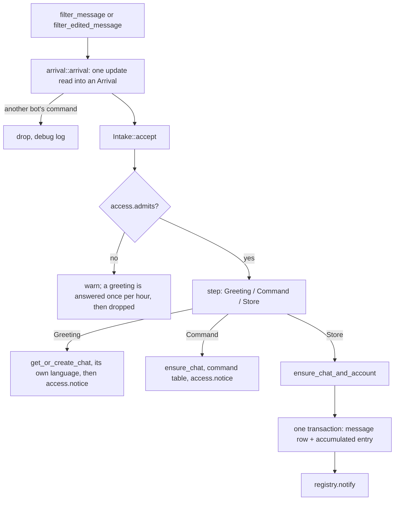

# Platform Integration

> The channel traits, message entry, internal commands, the send chain, file access, supervision and shutdown. Must-read when changing `platform/`.

## Overview

Telegram is the only platform implementation. The layer holds one tail per direction and one module per platform's adapter:

- `platform/outbound.rs:OutboundRecorder` — the outbound tail: resolving an internal target to the platform's address, holding the reference to the conversational rules, and recording the row that says the message left.
- `agent/intake.rs:Intake` — the inbound tail: admission, the command fork, resolving the chat and its account, one-transaction ingest, the doorbell. The platform layer hands it an `Arrival` and nothing else.
- `platform/host.rs:ChannelContext` — what one supervised run reads (the adapter, the inbound path, the chats' agents, the token); `platform/host.rs:ChannelRuntime` pairs it with the supervisor handle the host stops.
- `platform/telegram/` — the adapter: teloxide's dispatcher, the update→`Arrival` mapping, the command spelling, the menu, MarkdownV2, the rich-message POST, the send calls, file access, forms and receipts.

The agent speaks `agent/channel.rs:Channel` and `agent/channel.rs:ChannelAccess`; a platform implements `platform/adapter.rs:ChannelAdapter`, which only this layer names.

## Design

### The channel traits

`agent/channel.rs:Channel` is what the platform layer implements for one configured channel: its key (the storage spelling, prepared once where the channel is built), its profile, and the calls that act on a chat. The agent holds it through `agent/channel.rs:ChannelHandle`, which binds the chat that agent runs in — bound once where the agent is created (`agent/runtime/registry.rs:AgentRegistry::spawn`) — so a send, a typing indicator or a platform file never re-state which chat they mean, and a verb that takes no chat acts on the channel itself. `agent/channel.rs:ChannelCapabilities` is what that channel declares about itself, and the send tool derives its whole advertised surface from it, so a platform is never asked for what it cannot do (`docs/topics/tools.md`).

`agent/channel.rs:ChannelAccess` is the inbound half: `admits` (whether a chat may use this channel, in the platform's own id spelling) and `notice` (host copy, never stored). `platform/adapter.rs:ChannelAdapter` declares it as a supertrait, so whatever this layer hands the tail provably answers it and no forwarding code exists.

`platform/adapter.rs:ChannelAdapter` is the platform layer's own contract, implemented once per platform. `platform/outbound.rs:OutboundRecorder` implements `Channel` over it, and the inbound tail holds its access half. An adapter therefore reads no domain rows and holds no process container: `platform/telegram/adapter.rs:TelegramAdapter` is its client, its service, its file cache and its own `TelegramConfig`.

### Modules

`platform/host.rs` (`ChannelHost`) owns every channel's lifecycle and their one shutdown deadline; it resolves each `[channel.<name>]` section's platform by its `type` or its name, creates the channel's stop token, and dispatches to that platform's spawner, which hands the adapter back for `platform/host.rs:ChannelRuntime::assemble` to build around. `agent/intake.rs` is the inbound tail, `platform/outbound.rs` the outbound one. `agent/runtime/task_watcher.rs` turns due `scheduled_task` rows into accumulation entries and rings the agent; `agent/runtime/startup_refeed.rs` rings the agent for every chat whose accumulation a crash left unconsumed. Under `telegram/`: assembly and supervision (`builder.rs`), routing (`dispatcher.rs`), the update→arrival mapping and the per-update helpers (`arrival.rs`), the command spelling (`command.rs`), this platform's own config (`config.rs`), sending and the adapter itself (`adapter.rs`, `service.rs`, `reply.rs`, `forms.rs`, `receipt.rs`), the typing indicator (`typing.rs`), the menu (`menu.rs`), and the MarkdownV2 normalizer (`markdown.rs`).

### Message entry

**Admission first, and the platform answers the id spelling.** `Intake::accept` asks `ChannelAccess::admits` with the chat's own external id, so a platform's allowlist format stays in its own module. An unauthorized chat is warned about and dropped; only its greeting is answered, and the claim is spent on every unauthorized arrival — one reply per chat per hour is the whole budget.

**Host copy is spoken in one language policy.** A chat we keep is answered in its own preference (`agent/settings.rs:Settings::language`), which is why a greeting registers the chat row first; a chat outside the allowlist is answered in the configured default, because it may have no row to read a preference from. The command table resolves the same way, so a chat never hears two languages.

**Persist before the doorbell.** One transaction writes the message row and appends the change to `conversation.pending` — a `message_created` entry for a new message, a `message_edited` one for an edit — and only then is the agent rung (`agent/intake.rs:Intake::accept` → `domain/service/platform.rs:PlatformService::apply_platform_change`). The doorbell carries nothing: the agent re-reads the accumulation, so there is one copy of the state and no cursor to keep in step. A host command is answered without being stored; an agent task joins the same accumulation as a command entry (`docs/topics/commands.md`). What the platform derives is who the change was aimed at (`domain::vo::EntryAudience`: a Private chat, a mention of the bot account or a reply to one of its messages — `platform/telegram/arrival.rs:audience_of`).

**Edits.** `Update::filter_edited_message` shares the arrival path but never the command path: an edit cannot be an invocation (`platform/telegram/arrival.rs:change_kind` requires the platform's own edit time and errors without it). A message the bot sent itself is skipped — only its sender can edit it. The platform's own signal is the authority: the arrival of `edited_message` *is* the edit, so no comparison of content decides anything; `edit_date` only guards idempotency (`message.edited_at` older than or equal to the stored one is a redelivery and is dropped whole). Content is replaced in place — text and attachment rows — and no earlier wording is kept.

**Deletions are not visible.** Telegram sends no update when a message is deleted in an ordinary chat; only a bot connected to a Telegram Business account gets `deleted_business_messages`, and this implementation has no Business path. A deleted message therefore stays in the store as it was, and nothing here can change that.

### Commands

The table, who a slash message belongs to, and the replies are `docs/topics/commands.md`. The platform contributes the adapter: `platform/telegram/command.rs:classify` splits a slash message and decides whose it is (`arrival.rs` turns that into the arrival's `ArrivalText`, `/start` included), and `platform/telegram/menu.rs:install` pushes the menu from the command table once per channel. The tail runs the table (`agent/intake.rs:Intake::run_command`): a command of ours registers the chat without its sender (a command carries no message, so no account is needed) and either answers from host copy through `ChannelAccess::notice` or enqueues the agent task; a slash name the table does not know is ordinary conversation.

### Host copy and the command menu

Host copy is one vocabulary in `agent/copy.rs`: `HostCopy` says what the host says, `HostCopy::render` says it in the chat's built-in set — the language replies name a language through `agentcore/language/mod.rs:Language::names` — and the inbound tail only hands it to `ChannelAccess::notice`. No reply is assembled from literals at the call site.

The menu follows the **client's** language rather than the chat's: `platform/telegram/menu.rs:scopes` pushes the English catalog as the scope without a `language_code` — the fallback a client whose language has no scope of its own reads — plus one `language_code` scope per client code reading another catalog, and that code is a two-letter ISO 639-1 one, the only form Telegram accepts (`platform/telegram/menu.rs:install`). Members of one chat can read menus in different languages, a client in any other language reads English, and a regional variant reads its base language's entry. Names and descriptions come from the command table.

### Send chain

`platform/telegram/config.rs:TelegramConfig.rich_message` selects the chain: enabled, a raw HTTP POST to the rich endpoint → MarkdownV2 → plain text; disabled, straight to MarkdownV2 → plain text. The text that left is persisted as the message's text.

The outbound tail resolves the target first (`platform/outbound.rs:OutboundRecorder::send`): the chat's external id, and for a `reference` the target message's own platform id plus the excerpt, held to what the conversation allows — the target must be a message of the same chat, an excerpt must be a verbatim part of what it answers and non-empty, and in a one-to-one chat a reference to the newest thing the person said is dropped as the whole conversation already. A target that carries no platform id fails the send with a readable error instead of dropping the reference silently — the model sees the error in the tool result and resends. `topic_id` is validated against the chat before the row is written. The adapter then applies Telegram's own field ceiling, so an excerpt its field cannot hold fails before the platform refuses the whole send.

Every send arm builds its receipt through `platform/telegram/receipt.rs:receipt`, so the platform's own id and time are read in one place. After the platform accepted the send, the tail records what left: one message row with the platform's own id and time, the model that answered, and one attachment row per file the receipt carried. The account the row names is the adapter's own profile answer, asked once where the recorder is built. A receipt without a download handle keeps the row's own occurrence id, which no platform handle can collide with.

### The typing indicator

The indicator is decoration the platform owns. The agent asks for one where a run composes a reply and holds the guard for as long as the run lives — a Turn does, a wrap-up does not — and dropping the guard ends what the platform started (`agent/channel.rs:TypingGuard`). What keeps it alive between those two points is the platform's own fact — a repeat on its own cadence, one call that expires by itself, an explicit stop — so the cadence and the stop live in that platform's module, in its own constant and its `Drop` (`platform/telegram/typing.rs:TelegramTyping`). Nothing declares whether a platform shows an indicator at all: it answers with a guard or with `None`.

### Media analysis and attachment rendering

The platform resolves one file handle to its bytes or its URL (`platform/telegram/service.rs:TelegramFiles` behind `agent/channel.rs:Channel`'s `download_file`/`file_url`) and stops there: which parser reads a file, which payload it needs and where the result is cached belongs to `agent/multimodal/analysis.rs:MediaAnalyzer`, shared with the local-file and URL sources the `read` tool serves. The attachment row decides the parser (its kind, or the file name for a document) and the perception subject; audio needs bytes from the FileCache, while image, OCR and video go by file URL and are never downloaded. That cache is a download shortcut, not storage: entries not written for a week are swept on a write cadence (`util/cache.rs:FileCache::sweep`), so a deployment's disk does not grow with every attachment it has ever read. The codec an audio or video model is told about is the platform's own media type when the update carried one (`domain/vo/content.rs:AttachmentMeta::media_codec`, filled from `mime_type`), and the kind's default only when it did not. A sticker is sniffed first and errors out when its bytes are not an image a vision model can read (animated `.tgs`, video-sticker WebM). Rendering gives each attachment an `<attachment>` element with the base transcription (`focus = N…`).

### Supervision and restart

A channel supervises generations — dispatcher plus scheduled-task watcher, each held by a `platform/task.rs:TaskGuard` so the generation that owns it aborts it when it ends. Any exit other than a cancellation restarts after a backoff of 1 s doubling to a 60 s cap, reset by a generation that lived 60 s. Only that pair is replaced, so a restart keeps what outlives it: the shared `AgentRegistry`'s live ChatAgents, and the channel's one inbound tail with the period it has already answered an unauthorized chat in (`platform/host.rs:ChannelContext`). Stopping a generation shuts its `ShutdownToken` down before aborting at 5 s: cancelling an in-flight GetUpdates long poll would surface a spurious error.

### Shutdown orchestration

`app/mod.rs:serve` is the sole orchestrator: signal → cancel every channel's token → supervisors and registries joined against one deadline → event bus flushed. The cancel comes first because the token cascade is what starts each subsystem's shutdown, and joining only afterwards lets the whole stop finish inside one shared deadline instead of stacking per-subsystem windows.

- **dispatcher** — stops polling, discarding the in-flight GetUpdates.
- **ChatAgent** (`agent/runtime/registry.rs:AgentRegistry::drain`) — Idle takes the signal at once; a Busy run is cut by the same token, so it ends without consuming anything and the agent exits from Idle. Queued events are neither decided nor dispatched, and a pending chapter wrap-up waits for the next run's idle tick (`docs/topics/chat-agent.md`).
- **event bus** — `agent/runtime/event/bus.rs:AgentEventBus::flush` persists what is left.
- **abandonment** — a missed deadline is warned about and dropped; `ChannelHost` `Drop` cancels and aborts.

## Boundaries

- Telegram only: `domain/model/account.rs:Platform` has one variant.
- The platform reads its wire format into the neutral shape (an `Arrival` on the way in, a `SentMessage` receipt on the way out) and derives only who a change was aimed at — it never interprets content.
- The arrival path adds no error handling of its own; the persistence it feeds is what can fail.

## Trade-offs and Reasons

- **Rich messages are opt-in** — the rich endpoint is not in teloxide, so that path is a hand-rolled HTTP POST gated by `TelegramConfig.rich_message`.
- **MarkdownV2 is preprocessed, not escaped wholesale** — `platform/telegram/markdown.rs:markdown_v2` keeps paired entities and escapes the rest; the price is a normalizer that must track Telegram's entity rules.
- **Persist before the doorbell** — the change is durable in the accumulation before the agent hears about it, so a crash costs a doorbell, never a change; the price is one read of the accumulation per arrival.
- **The reply rules are shared, the field ceiling is not** — which reference may go out is conversation, so it lives in `platform/outbound.rs`; how long a quote Telegram accepts is its own wire fact, so it lives in `platform/telegram/reply.rs`. A platform with a different ceiling enforces its own.

## Pitfalls / common mistakes

- **Unauthorized chats are silent** — only a greeting is answered, once per hour per chat; the rest is dropped after a warn log. An empty `allowed_chat_ids` rejects every chat (`platform/telegram/config.rs:TelegramConfig::parse` warns at startup).
- **`platform/telegram/markdown.rs:markdown_v2` guarantees a parseable message** — paired entities survive and everything else is escaped, so the fallback fires only on network or permission failures.
- **Mention offsets are UTF-16** — `platform/telegram/arrival.rs:is_mentioning_user` re-encodes through `platform/telegram/arrival.rs:check_entities` before slicing, because Telegram counts UTF-16 code units; indexing by `char` misaligns and can panic.
- **A reply to the bot's own message counts as a mention** (`platform/telegram/arrival.rs:is_reply_to_bot`), with no `@` needed.
- **Keep teloxide's `enable_ctrlc_handler` off** — it is a second SIGINT consumer that cancels the in-flight GetUpdates mid-connect, which the default error handler logs as an ERROR.
- **An attachment is addressed by its occurrence id** (`agent/tools/read/media.rs:Read::read_attachment` → `agent/multimodal/analysis.rs:MediaAnalyzer::analyze_attachment` → `MessageService::attachment_by_id`), a primary-key lookup on `attachment.id`; the id is what `<attachment id="…">` renders and what the model hands back.
- **A legacy bot account is adopted once** — a database written before bot accounts carried their key holds one shared `(system, 'bot')` row; `domain/service/platform.rs:PlatformService::ensure_bot_account` rewrites it to this channel's own `(platform, bot:<key>)` so the history that references its id stays the bot's own.

## Evolution Direction

A second platform follows the checklist in `docs/architecture.md`: a new submodule under `platform/` implementing `ChannelAdapter` with its own config, one arm in `ChannelHost::spawn_all`, and one variant in `domain/model/account.rs:Platform`.
